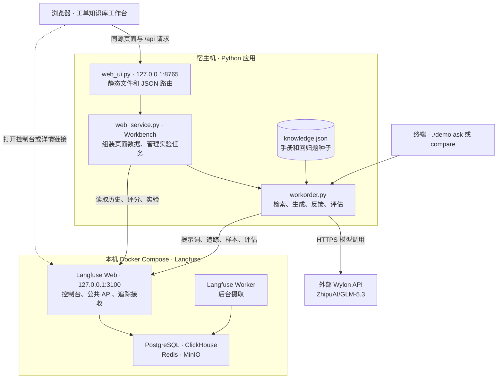
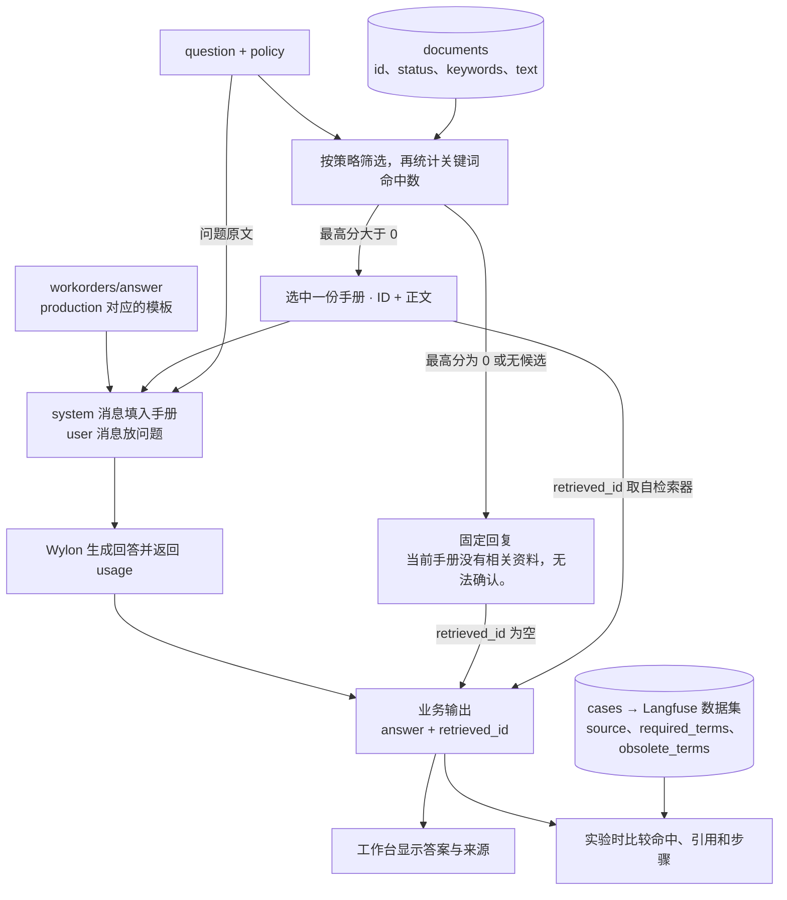
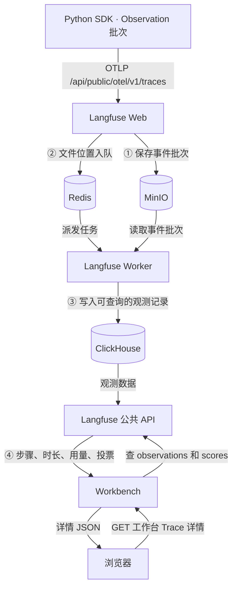
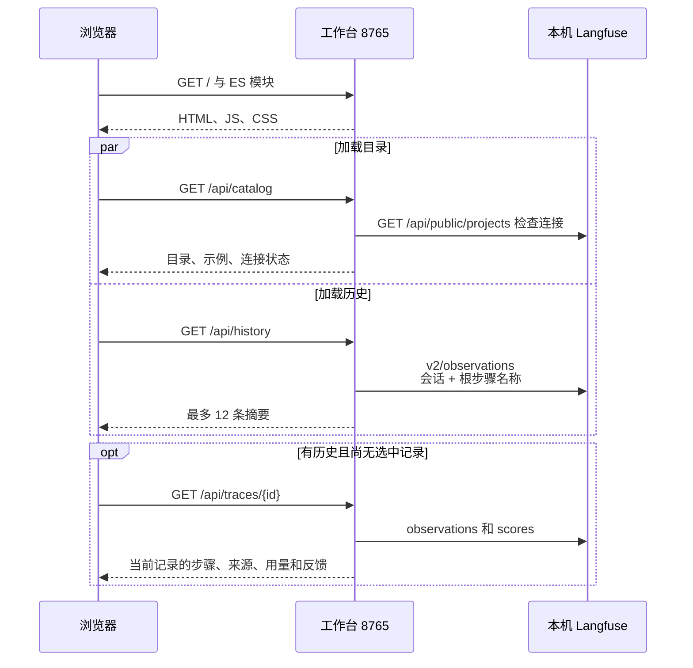
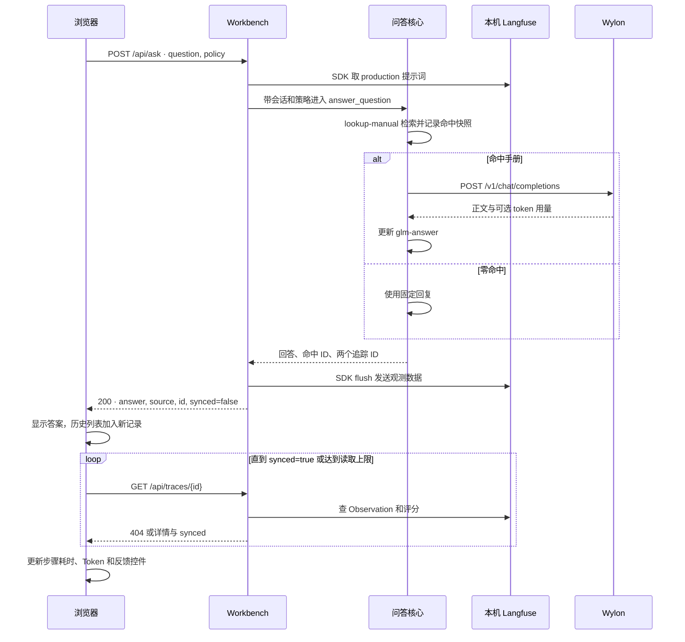
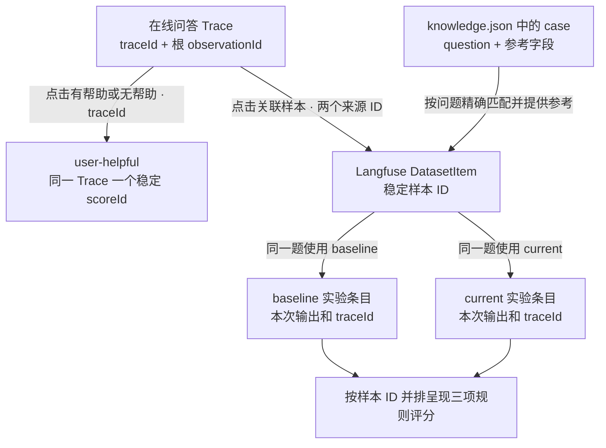
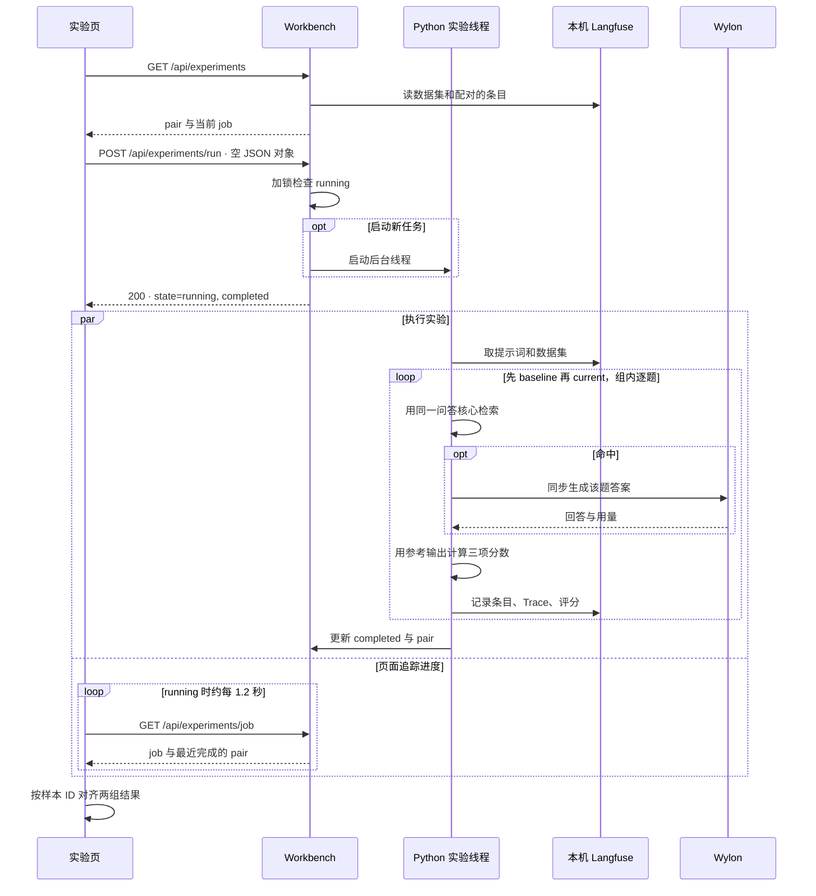

# 工单知识库 Demo 架构与数据流

用户问“怎样批量导出工单？”时，Python 从三份手册中选出一份，Wylon 根据它生成回答，本机 Langfuse 记录检索和生成各自的输入输出。问答页先显示答案，再补齐 Trace。手册页可查原文，实验页则把两种策略对同一道题的结果放在一起比较。

本文分析 2026-11-25 的工作区实现。Langfuse 服务端配置为 `4.86.0`，Python SDK 固定为 `5.2.0`。末节给出本机已有 Trace 和同批实验的实际读数，可对照正文核查。[服务端配置](local_setup.py#L50) · [Python 依赖](pyproject.toml#L1)

## 1. 两个网页入口，一个问答核心

**图 1　部署边界和调用方向。** `8765` 同时提供工作台页面和业务 API。`3100` 提供 Langfuse 原生控制台、公共 API 和追踪接收端。提问走 Python 的业务接口。侧栏的“Langfuse 控制台”、答案的 Trace 链接和实验页的比较链接，都指向另一端口上的原生控制台。



| 组件 | 具体职责 | 状态由谁保存 |
| --- | --- | --- |
| 浏览器里的工作台 | 原生 HTML、CSS 和 ES 模块。`app.js` 处理问答、历史和 Hash 导航，`experiments.js` 处理实验，`manuals.js` 处理手册，`common.js` 封装同源 `fetch` 和 DOM 操作。 | 当前选中的 Trace、最近记录、已确认投票、待处理操作和手册筛选保存在页面内存。 |
| HTTP 适配层 | `LocalServer` 继承标准库的 `ThreadingHTTPServer`，监听回环地址，按允许清单返回静态资源，把 JSON 请求交给同一个 `Workbench`。 | 每个 HTTP 请求有自己的处理上下文，服务进程共享 Langfuse 客户端与工作台实例。 |
| 工作台服务层 | 把 Langfuse Observation、Score、Experiment 转成前端需要的字段，并安排网页发起的后台实验。 | `job`、互斥锁和 `last_result` 只在当前 Python 进程中。 |
| 问答与评估核心 | CLI、网页提问、两种策略的实验都调用 `answer_question`。检索和评分由 Python 实现，模型生成通过 `httpx` 调用 Wylon。 | 模块导入时加载 `knowledge.json`。常驻工作台重启后才会读取修改过的手册。 |
| 本机 Langfuse | 管理提示词版本、样本、实验和反馈，接收追踪，供页面和原生控制台查询。 | 数据由 Compose 卷持久化，工作台进程重启后仍可读取。 |

启动时，`./demo up` 准备经过 SHA-256 校验的上游 Compose 与本机配置，启动 Langfuse Web、Worker 及依赖，按锁文件同步 Python 环境。初始化通过公共 API 等待项目就绪，缺少 `production` 提示词时创建模板，按稳定样本 ID 补齐缺少的回归题，最后启动网页服务。`./demo ui` 可单独启动网页，`./demo down` 停止服务并保留卷。MinIO 的 `3190` 映射到容器 `9000`。PostgreSQL、ClickHouse、Redis 和 Worker 使用容器网络。可选 AI Gateway 位于单独的 Compose profile，默认问答由 Python 直接发给 Wylon。[启动入口](demo#L5) · [初始化](workorder.py#L123) · [部署覆盖](compose.local.yaml#L1) · [HTTP 服务](web_ui.py#L109)

## 2. 一道题怎样变成回答

**图 2　问答的数据流。** `knowledge.json` 的 `documents` 提供检索材料，`cases` 提供独立的回归参考。两条线在评分时相遇。模型推理看到当次问题与选中的一份手册，历史问答用于工作台回看。



**检索。** `baseline` 保留所有文档，`current` 先过滤到 `status == "current"`。每个关键词只检查是否作为子串出现在问题中，每命中一个加一分。正分最高的候选胜出，并列时保留文件中排在前面的文档。导出问题同时包含“工单”“导出”“批量”，两版手册都是 3 分。归档手册排在第一条，所以 `baseline` 选 `EXPORT-2024`，而 `current` 过滤后选 `EXPORT-2026`。时区问题在两种策略下都选 `TIMEZONE-2026`。检索在本地 Python 列表上完成。[检索函数](workorder.py#L54) · [文档和样本顺序](knowledge.json#L2)

**生成。** 后端通过 SDK 按 `production` 标签取 `workorders/answer`，可复用提示词缓存。命中后，它把“文档ID + 换行 + 正文”放进模板的 `{{context}}`，再加一条只含当前问题的 `user` 消息。Python 以 Bearer 凭据向 Wylon 的 `POST /v1/chat/completions` 提交 `model=ZhipuAI/GLM-5.3`、两条 `messages`、`temperature=0`、`max_tokens=512`。从 `choices[0].message.content` 取正文，把供应商实际返回的整数 `prompt_tokens / completion_tokens / total_tokens` 映射为 `input / output / total`。服务端读取环境变量或本机密钥文件，浏览器只接收业务结果。零命中时直接返回固定回复。由于网页提问在检索前就取提示词、构造模型客户端，这个分支仍需要有效的本地配置。[凭据与模型请求](workorder.py#L62) · [消息构造和零命中分支](workorder.py#L88) · [工作台提问](web_service.py#L129)

**来源有两个核对点。** 右侧“命中手册”来自检索器的 `retrieved_id`，回答里的 `[EXPORT-2026]` 来自模型正文。前端只把索引里已知的方括号文档 ID 渲染成可点击引用。实验分别测量检索是否找对、模型是否引用正确，即使其中一步正确，另一项仍可以失败。[引用渲染](ui/app.js#L66) · [命中手册渲染](ui/app.js#L109) · [评分函数](workorder.py#L144)

## 3. Langfuse 怎样保存并还原一次执行

普通网页提问的根 Observation 叫 `workorder-answer`。Observation 是一次执行步骤，Trace 用同一个 `traceId` 把这些步骤归在一起。

| Observation | 输入 | 输出和元数据 | 出现条件 |
| --- | --- | --- | --- |
| `workorder-answer`，类型 `chain` | 问题字符串 | `{answer, retrieved_id}`、检索策略、起止时间 | 每次进入问答核心 |
| `lookup-manual`，类型 `retriever` | 问题、策略 | 命中文档的完整快照，零命中时为 `null` | 每次检索 |
| `glm-answer`，类型 `generation` | 实际送出的两条消息、模型参数、关联的提示词版本 | 回答正文和供应商返回的用量 | 命中文档时 |

**图 3　追踪写入和页面回读。** 下面是 Observation 的摄取路径。项目、提示词版本和数据集样本由 PostgreSQL 持久化。ClickHouse 保存可分析的追踪与评分，Redis 提供队列和缓存，MinIO 提供 S3 兼容的事件对象存储。[Langfuse 自托管架构](https://langfuse.com/self-hosting#architecture) · [v4.86.0 事件入队实现](https://github.com/langfuse/langfuse/blob/v4.86.0/packages/shared/src/server/otel/OtelIngestionProcessor.ts#L369-L405)



`Workbench.ask` 在返回前调用 `client.flush()` 发送 SDK 缓冲的数据。Langfuse Worker 随后处理入库，期间查询可能暂时找不到记录。浏览器先用当前请求算出的答案，再按 Trace ID 补齐详情。根记录可见后，`synced` 要求已读到 `lookup-manual`，同时满足“已读到 `glm-answer`”或“根输出 `retrieved_id` 为空”之一。供应商省略 Token 数时也可以满足该条件。控制台中的提示词以后可以换版本，历史 Generation 保留当时绑定的版本。[问答首包](web_service.py#L136) · [详情聚合](web_service.py#L107) · [Worker 摄取实现](https://github.com/langfuse/langfuse/blob/v4.86.0/worker/src/queues/otelIngestionQueue.ts#L615-L693)

## 4. 浏览器首屏、历史和手册索引

**图 4　打开问答工作台时的读请求。** 同一个 HTML 提供 `#workbench`、`#manuals`、`#experiments` 三个视图。前端根据 Hash 切换区域，直接打开实验页还会触发实验读取。



- **目录和连接。** `catalog` 的文档、示例题来自模块内存，`connected` 来自对 Langfuse 项目 API 的探测，最长等待 4 秒。探测失败仍可返回手册并显示离线。前端据此设置模型名、控制台链接、快捷问题和手册索引。这个指示灯只覆盖 Langfuse 连接。[目录聚合](web_service.py#L80) · [首屏赋值](ui/app.js#L40)
- **历史和会话。** 查询条件是 `name=workorder-answer`、`sessionId=workorder-local` 和 `limit=12`，随后去掉没有答案的条目。有历史时自动选第一条，点击其他行再读其详情。网页使用固定 Session，CLI 默认使用同一个值，也允许 `--session` 覆盖。不同标签页共用这个追踪分组。送给模型的消息只含当次上下文。[历史筛选](web_service.py#L102) · [历史合并](ui/app.js#L213) · [CLI 参数](workorder.py#L210)
- **手册交互。** 搜索在浏览器中匹配标题、ID 或关键词，再叠加现行/归档筛选。点击答案引用或“查看命中手册”会打开对应 ID。选“用此主题提问”仅回填问题并切回工作台，提交表单才发起模型问答。侧栏和详情里的 Langfuse 链接在新页打开。[手册索引](ui/manuals.js#L3) · [工作台与索引联动](ui/app.js#L11)

## 5. 从点击“运行问答”到 Trace 补齐

**图 5　提问时序。** 提问使用单次同步 JSON 请求，返回完整答案。详情读取另走可重试的 GET。图中的“取提示词”表示 SDK 调用，实际网络访问取决于缓存。



提交时，浏览器去掉问题首尾空白，读取表单中默认 `current` 或用户所选策略，并在请求期间禁用提交按钮。后端再校验去空白后长度 1–2000 及策略枚举。新问答以 `fresh` 标记按 ID 去重插入历史，刷新时保留尚未出现在 Langfuse 查询中的新条目。如果用户在等待时切换了历史项，新答复只提示“查看回答”，当前选择保留。追踪读取和历史刷新分别用递增版本号丢弃过时响应。[表单提交](ui/app.js#L239) · [历史合并](ui/app.js#L214) · [服务端校验](web_service.py#L129)

| 页面字段 | `POST /api/ask` 直接返回 | `GET /api/traces/{id}` 补齐或复核 |
| --- | --- | --- |
| `id / observationId` | 本次 Trace ID / `workorder-answer` 的 Observation ID | 从根记录的 `traceId / id` 还原，样本关联用到两个 ID。 |
| `question / policy / answer / source` | 规范化问题、所选策略、生成或固定回复、检索文档 ID | 取根节点的 `input`、`metadata.retrieval_policy` 和 `output.{answer,retrieved_id}`。 |
| `document` | 从进程内手册按命中 ID 取整份文档 | 来自 `lookup-manual.output` 的执行时快照。页面合并目录资料与快照，快照字段优先。 |
| `at / duration` | UTC 开始时间与 Python 计时的毫秒数，计时从取到提示词后开始，在 `flush` 前结束 | 根节点 `startTime` 和 `latency × 1000`，缺少 `latency` 时用起止时间差。两个耗时的测量范围不同。 |
| `model / promptVersion` | 命中时取调用配置和已解析的提示词版本 | 从 `glm-answer` 的记录读取。 |
| `lookupMs / generationMs / usage` | 首包省略两个分步耗时，`usage={}` | 从子节点取得时长和 `usageDetails`，页面显示总 Token，可查看输入/输出拆分。 |
| `vote / synced / url` | `null / false` 和原生 Trace 链接 | 读取 `user-helpful` 后映射为 `up / down / null`，按步骤是否齐全更新同步状态。 |

例如下列两个 JSON 片段分别展示**请求体**和**已有 Trace 详情中的部分字段**。`retrieved_id` 在后端核心和 Langfuse 根输出中使用，对工作台暴露的名称是 `source`。历史片段对应的是一次已经入库的调用。

```json
{"question": "怎样批量导出工单？", "policy": "current"}
```

```json
{
  "id": "26df1a83eddb70febce178e83c806bde",
  "observationId": "0dcf03092b5495a2",
  "answer": "进入「报表中心」，选择「工单导出」，然后创建导出任务即可批量导出工单。[EXPORT-2026]",
  "source": "EXPORT-2026",
  "promptVersion": 1,
  "lookupMs": 0,
  "generationMs": 1872,
  "duration": 1874,
  "usage": {"input": 102, "output": 146, "total": 248},
  "synced": true
}
```

详情聚合先请求 `GET /api/public/v2/observations`，按 `traceId` 取记录，再按步骤名称找到根、检索和生成节点。根缺失或归属其他 Session 时，工作台返回 404。根可见时再请求 `GET /api/public/v3/scores`，以 `traceId` 和 `name=user-helpful` 取一条评分。输入输出中的对象字段兼容字典和 JSON 字符串，避免历史记录的序列化差异影响展示。[详情聚合](web_service.py#L107) · [对象字段解析](web_service.py#L27)

**等待和恢复。** 选择 Trace 后立即查一次。遇到尚未就绪的 404 或 `200 + synced=false`，后续各次查询前分别等待 450、900、1600、3000、5000、8000 毫秒，最多七次。达到上限或出现其他错误，答案仍可阅读，并提供“重新读取”。首次历史读取失败且没有选中项时，还会在约 1.8 秒后尝试重新加载一次。切换 Trace 会让旧查询结果失效。[追踪读取](ui/app.js#L149) · [历史恢复](ui/app.js#L214) · [字段组装](web_service.py#L46)

## 6. 投票和关联样本怎样串起一次真实问答

**图 6　Trace、评分、样本和实验的关联。** 一次提问可以留下主观投票，也可以成为预设回归题的来源。重跑实验使用样本的输入和参考输出，每次重跑又有自己的 Trace。



- **投票按 Trace 更新。** 同步完成后，前端发送 `POST /api/traces/{id}/feedback`，负载是 `{"vote":"up"}` 或 `{"vote":"down"}`。后端写布尔型 Score `user-helpful`，值为 1 或 0。其 ID 为 `UUIDv5(NAMESPACE_URL, "local-vote/" + traceId)`，所以同一条 Trace 改投仍对应同一条评分。前端等待成功回执后更新按钮，并在本页暂存已确认值。读回的投票与本页一致后清除暂存，期间仍显示刚刚确认的投票。[评分写入](workorder.py#L48) · [后端回执](web_service.py#L150) · [前端投票](ui/app.js#L276)
- **样本按问题关联。** 同步完成且问题与 `cases` 中某题完全匹配时，前端允许提交 `POST /api/traces/{id}/sample`，负载为 `{}`。后端重新查 Trace，取根节点的两个来源 ID，以 `{question}` 为输入，取本地预设的 `source、required_terms、obsolete_terms` 为期望输出。样本 ID 为 `UUIDv5(NAMESPACE_URL, "workorder-regression/" + question)`。用相同 ID 再关联会更新对应样本及其来源，原回答的错误可以保留在 Trace 里，同时样本继续使用正确参考。前端“已关联”标记的生命周期是当前页面。[样本关联](web_service.py#L158) · [稳定 ID 与写入](workorder.py#L111) · [前端控件](ui/app.js#L123)

## 7. 回归实验怎样执行、轮询和恢复

**图 7　实验时序。** 网页实验占用一个 Python 后台线程。Docker 里的 Langfuse Worker 负责摄取观测，实验线程负责调用模型和评价样本。这两个执行者的任务不同。



`start_experiment` 遇到运行中的任务直接返回当前状态。浏览器标签页共享同一个任务槽和进度地址。CLI 的比较运行在独立进程中。`completed` 统计已完成的策略组，范围 0–2。运行中可能同时读到上一组已完成的 `pair`。失败时 `job.state=error`，保留已完成组数并附 `message`，前端显示任务错误并结束这轮轮询。进度 GET 自身失败时，页面提供“重新读取进度”。重启 Python 会使任务状态回到 `idle`，已经进入 Langfuse 的实验可从实验页重新读出。[任务状态和锁](web_service.py#L198) · [轮询与恢复](ui/experiments.js#L90)

每次比较从 Langfuse 的 `workorder-regression` 读取当前样本，两次运行共享模型和已取到的提示词对象，运行名共用 UTC 时间戳。`dataset.run_experiment` 设置 `max_concurrency=1`，两种策略顺序执行。对于默认的两道题，两种策略都能命中，因此完整比较产生四次模型调用。代码检查每组返回了全部样本，且每条有预期的三种评分，才将该组计为已完成。CLI 的 `./demo compare` 复用同一生成器，在终端同步输出并排比较链接。[比较循环](workorder.py#L157) · [终端入口](workorder.py#L182) · [网页运行器](web_service.py#L217)

| 评分 | 输入和判定 | 能回答什么问题 |
| --- | --- | --- |
| `retrieval-correct` | `output.retrieved_id == expected_output.source` | 检索器选中了正确的手册吗？ |
| `citation-correct` | 从正文提取形如 `[EXPORT-2026]` 的 ID，去重后集合必须恰好等于包含预期来源的集合 | 模型把答案归给了正确文档吗？ |
| `steps-correct` | 正文包含全部 `required_terms` 且不包含任何 `obsolete_terms` | 答案实际包含现行操作步骤吗？ |

实验页要求同一条样本三项都为 `1` 才计作通过，用 `通过样本数 / 本组样本数` 展示，缺失分值显示“待评分”。后端把实验结果规整为 `{id, question, expected, answer, source, scores, traceId}`，前端按相同样本 ID 对齐两组并优先展示通过状态有差异的题。打开已有实验时，服务端分页读取自数据集创建以来的实验，找到同一时间戳下的 `baseline-*` 和 `current-*`，再读取两组明细，与本进程的 `last_result` 比较时间戳取较新者。仅查看进度的 `/job` 直接返回内存快照。[规则实现](workorder.py#L144) · [历史实验配对](web_service.py#L166) · [前端合并和展示](ui/experiments.js#L39)

## 8. 工作台 HTTP 接口总表

路径均相对于 `http://127.0.0.1:8765`。浏览器的 `api(path)` 默认 GET，传入第二个参数时发送 JSON POST。表中的 `{id}` 是 32 位小写十六进制 Trace ID。

| 方法和路径 | 触发动作 / 请求体 | 返回值及去向 |
| --- | --- | --- |
| `GET /api/service` | 启动脚本探测工作台 | `{service, pid}`，用于识别和管理本机服务进程。 |
| `GET /api/catalog` | 首屏、重试连接 | `{model, connected, projectUrl, documents, cases, dataset}`，提供导航链接、示例和索引。 |
| `GET /api/history` | 首屏、点击刷新 | 根 Observation 的摘要数组，包含 `id, observationId, question, answer, source, policy, at, duration`。 |
| `POST /api/ask` | 提交 `{question, policy}` | 直接返回问答对象，含 Trace ID、答案、命中手册和初始同步状态。 |
| `GET /api/traces/{id}` | 选历史记录、提问后补齐、手动重读 | 单条问答、文档快照、模型与提示词版本、用量、总耗时和分步耗时、投票、同步标记、原生链接。 |
| `POST /api/traces/{id}/feedback` | `{"vote":"up"}` 或 `{"vote":"down"}` | `{vote}`，前端更新该 Trace 的反馈状态。 |
| `POST /api/traces/{id}/sample` | 关联预设回归题，`{}` | `{id}`，此 ID 是数据集样本 ID。 |
| `GET /api/experiments` | 进入实验页、重新读取 | `{pair, job}`。`pair` 可以为空，有结果时含 `stamp, at, runs, url`。 |
| `POST /api/experiments/run` | 运行回归，`{}` | 直接返回 `{state, completed}`，新启动和已在运行均由此入口响应。 |
| `GET /api/experiments/job` | 任务进度轮询 | `{job, pair}`，其中 `pair` 是本进程最近完成的一对结果或 `null`。 |

成功 JSON 响应均为 HTTP 200，响应禁止缓存。POST 接收 1–32768 字节的 JSON 对象，并校验本机 Host 与浏览器提供的 Origin。业务参数或 JSON 无效返回 400，来源校验失败为 403，不能定位到工作台会话的 Trace 或路由不存在为 404，长度不符合要求为 413，媒体类型不符为 415。依赖异常、模型超时、供应商错误状态或空回答等会通过统一错误对象 `{"error":"…"}` 返回，通用状态码为 503。前端按操作位置显示失败消息，追踪短暂不可见有独立的重读逻辑。[路由与错误处理](web_ui.py#L43) · [错误归一化](web_service.py#L56) · [前端请求封装](ui/common.js#L47)

## 9. 用本机已有数据核对

2026-11-25 只读查看的成对实验名共用时间戳 `20261125-094555-633313`（UTC）。以下是 Langfuse 保存的逐题分数，列内顺序为检索 / 引用 / 步骤。

| 数据集样本 | 参考文档 | `baseline` 实际来源与三项得分 | `current` 实际来源与三项得分 |
| --- | --- | --- | --- |
| 怎样批量导出工单？ | `EXPORT-2026` | `EXPORT-2024` · 0 / 0 / 0 | `EXPORT-2026` · 1 / 1 / 1 |
| 在哪里修改时区？ | `TIMEZONE-2026` | `TIMEZONE-2026` · 1 / 1 / 1 | `TIMEZONE-2026` · 1 / 1 / 1 |

真实浏览器里，两组通过数分别是 **1/2 与 2/2**。另外两条交互式导出问答都记录了 Prompt v1。含归档的 Trace 命中旧手册，收到 `down` 投票，记录 215 个 Token。仅现行的 Trace 命中新手册，记录 248 个 Token。检查时 `production` 标签已经指向 v4。复盘某次回答应读取该次 Generation 上的 `promptVersion`。[含归档的历史 Trace](http://127.0.0.1:3100/project/workorder-demo/traces/e267e2c21cf92b3f26d9aae957a35ce4) · [仅现行的历史 Trace](http://127.0.0.1:3100/project/workorder-demo/traces/26df1a83eddb70febce178e83c806bde) · [该组成对实验](http://127.0.0.1:3100/project/workorder-demo/experiments/results?baseline=8639b9b04ac51490&c=d9c4199a934c4b9c)

验证时浏览器实际读到了目录、历史、单条 Trace 和既有实验，并确认手册搜索与回填问题产生 0 次额外 API 请求。提问、改投、关联样本、启动任务与轮询的浏览器请求用拦截响应做了回放，模型请求体和零命中分支用隔离的模拟供应商核对。本次分析的模型输出与评分证据取自上面的既有记录。
