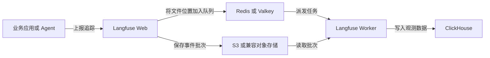

# Langfuse 仓库调研报告

调研日期为 2026 年 11 月 25 日。源码基线为当日 GitHub 标记的最新正式版 **v4.86.0**，对应提交 `cb335bf`。[GitHub 正式发布记录](https://github.com/langfuse/langfuse/releases/tag/v4.86.0)

**Langfuse 是面向大语言模型（LLM）和 AI Agent 应用的工程平台。** 业务应用负责检索资料、调用模型和执行工具，Langfuse 则把这些步骤串成一条可查看的请求记录，并关联实际使用的提示词版本、耗时、费用和质量评价。有了这条记录，团队可以还原用户当时的经历，找出值得修改的步骤，再检验改动有没有减少同类错误。[仓库 README](https://github.com/langfuse/langfuse/blob/v4.86.0/README.md) · [官方产品文档](https://langfuse.com/docs)

## 为什么需要这个仓库

想象一个客服助手。用户问怎样批量导出工单，助手在两秒内给出完整步骤，接口返回 HTTP 200。用户照着操作，却找不到回答中提到的按钮。服务监控记录的成功和用户遇到的失败可以同时成立。要修复它，工程师需要知道检索器取回了哪版手册、拼装后的提示词包含哪些段落，以及模型最终引用了哪段内容。

现有工具各自保留了部分证据。应用日志和分布式追踪能查异常、耗时和服务调用关系，模型供应商记录用量，Git 保留纳入版本控制的提示词和业务代码。团队也可以自行扩展这些工具。额外的工程量在于给不同来源的数据建立共同标识，把用户反馈挂回具体回答，并把出过错的问题保留为下一次发布能重跑的测试。Langfuse 把这套工作做成了可供不同应用共用的平台。[OpenTelemetry 对追踪的定义](https://opentelemetry.io/docs/concepts/observability-primer/) · [Langfuse 数据模型](https://langfuse.com/docs/observability/data-model) · [评估与实验概念](https://langfuse.com/docs/evaluation/core-concepts)

项目的演进也解释了这个选择。根据创始团队的回顾，2023 年他们自己开发 AI 应用时，就遇到从原型走到可靠产品需要反复评估的问题。2023 年 7 至 8 月，团队以 LLM 应用产品分析工具的定位公开发布，初期集中做追踪。2024 年 1 月，用户希望把提示词变更和线上表现联系起来，团队加入提示词管理。同年 4 月又推出 Playground、数据集和模型评审，让开发者能拿已有问题测试新方案。[创始团队的项目历史](https://langfuse.com/handbook/chapters/story)

独立且公开的仓库还有一层价值。应用可能横跨不同模型、编程语言和框架，团队也可能要求客户对话留在自己的基础设施里。公开服务端、提供标准追踪入口和自托管选项，使团队能检查数据处理方式、接入自己的技术栈，并选择数据存放位置。这也是维护者列出的开源动机。[维护者对开源的说明](https://langfuse.com/handbook/chapters/open-source) · [自托管架构](https://langfuse.com/self-hosting)

## 平台具体解决哪些问题

从用户提问到返回答案，通常是一条 **Trace（请求链路）**。链路里的每一步是一条 **Observation（观测记录）**，可以按父子关系嵌套，其中模型调用常记为 **Generation**。连续几轮提问可以共用一个 **Session（会话）**。评价单独记为 **Score**，所以稍后收到的用户反馈或人工复核结果也能关联回相应的请求或步骤。[观测数据模型](https://langfuse.com/docs/observability/data-model) · [观测类型](https://langfuse.com/docs/observability/features/observation-types) · [评分接口定义](https://github.com/langfuse/langfuse/blob/v4.86.0/fern/apis/server/definition/scores.yml)

| 团队遇到的问题 | Langfuse 提供的机制 | 能据此作出的判断 |
| --- | --- | --- |
| 回答错了，或者某轮特别慢 | 查看一次请求的步骤树、时间线，以及采集到的输入和输出。多轮对话可按 Session 串联。 | 检查哪一步首次出现错误信息，或区分检索等待、工具重试和模型生成各自占用的时间。[可观测性文档](https://langfuse.com/docs/observability/overview) |
| 编辑过多版提示词，线上究竟用了哪一版 | 给模板保留版本，用 `production` 等标签指向发布版本，应用可将实际取得的版本关联到 Generation。SDK 支持本地缓存和后台刷新。 | 从一条差评回到当时的模板和输入，比较各版本的质量和成本，必要时将标签移回旧版。版本切换到运行实例的时间还受缓存刷新影响。[版本控制](https://langfuse.com/docs/prompt-management/features/prompt-version-control) · [关联调用](https://langfuse.com/docs/prompt-management/features/link-to-traces) · [缓存机制](https://langfuse.com/docs/prompt-management/features/caching) |
| 换了模型或改了检索逻辑，几次手测都正常，能否发布 | 把样本组织为 Dataset，在相同数据上运行多个方案。可以用代码规则、人工标注或另一个模型按明确标准评分。线上也可以按条件抽样评估。 | 并排看每道题的输出，找出改善项和新引入的错误。上线后再观察真实请求中同类错误的比例。[评估机制](https://langfuse.com/docs/evaluation/core-concepts) · [SDK 实验](https://langfuse.com/docs/evaluation/experiments/experiments-via-sdk) · [线上评估](https://langfuse.com/docs/evaluation/get-started/online) |
| 账单上涨，想知道是哪个功能、哪类用户造成的 | 记录模型、token 用量、费用和耗时，按业务上报的用户标识、标签或请求名称分析。费用优先采用上报值，也可根据模型价格和用量推算。 | 区分流量增长、上下文变长和一次请求多次调用。价格配置、自定义折扣和采样范围会影响估算与账单的吻合程度。[成本计算规则](https://langfuse.com/docs/observability/features/token-and-cost-tracking) · [指标与维度](https://langfuse.com/docs/metrics/overview) |
| 多个团队各自保管模型密钥，用量难归属 | 可选的 **AI Gateway（Beta）** 统一转发模型请求，集中管理供应商凭据和可用模型。 | 按用户或服务密钥查到经网关调用了哪些模型、消耗了多少。检索和本地工具的执行细节由应用侧补充上报。[AI Gateway](https://langfuse.com/docs/gateway/overview) |
| Agent 的操作说明与配套资料经常一起变化 | **Skill Management（Beta）** 给包含 `SKILL.md` 和附属文件的技能包做版本管理。 | 把技能版本和运行记录关联起来，查看 Agent 加载了哪版说明，并可用标签推广或回退整套文件。[Skill Management](https://langfuse.com/docs/skill-management/overview) |

## 一条错误回答怎样变成回归测试

以下沿用“批量导出工单”的假设案例。这个助手采用检索增强生成（RAG），先从产品手册检索相关段落，再交给模型组织答案。

1. **找到原始回答。** 用户点“无帮助”时，业务应用将反馈和这轮请求的 Trace ID 一起上报。客服可以找到原话、答案及同一会话的上下文。这个评分说明用户遇到了问题，具体原因还有待检查。[评分接口](https://github.com/langfuse/langfuse/blob/v4.86.0/fern/apis/server/definition/scores.yml)
2. **定位最早出错的一步。** 假设应用在检索步骤记录了返回的文档 ID 和版本，在生成步骤记录了送给模型的上下文。展开链路后发现，检索返回的是已归档手册，模型照着里面的旧菜单作答，现行手册没有进入上下文。此时有证据优先检查检索过滤条件。如果传入的是现行手册，而最终答案凭空增加了一个按钮，则应检查生成步骤和提示词。两个故障在聊天界面上看起来几乎一样。[观测类型与输入输出](https://langfuse.com/docs/observability/features/observation-types)
3. **用一组样本验证修复。** 把这次请求存为数据集样本，附上现行文档 ID 和预期操作步骤，再加入其他产品版本、相似菜单和本来就能答对的问题。固定数据集、模型、提示词和索引快照，只改变“是否排除归档手册”，通过 SDK 跑两组完整流程。用代码检查引用的文档版本，请熟悉产品的人复核操作步骤。这样既能看到原问题是否修好，也能看见过滤条件是否误伤其他问题。[从追踪创建数据集](https://langfuse.com/docs/evaluation/experiments/datasets) · [实验数据模型](https://langfuse.com/docs/evaluation/experiments/data-model)
4. **在真实流量中检查结果。** 发布后，对同类问答按相同规则抽样，观察“含失效引用的回答数占已评审回答数的比例”，同时看新增过滤带来的耗时和每次回答成本。把流量构成、抽样范围和人工复核口径一并保留，后续才能解释比例为什么变化。[线上评估与采样](https://langfuse.com/docs/evaluation/get-started/online) · [指标分析](https://langfuse.com/docs/metrics/overview)

一个真实的协作例子来自 Canva。根据 Langfuse 发布的客户访谈，Canva 的 Java 客服助手通过 OpenTelemetry 接入，Python 侧的 Agent 使用原生 SDK。工程师排查调用链，QA 通过标注队列评分，日本市场的一位营销经理则设置了模型评审器，专门检查日语回答是否符合当地的正式商务语气。这个例子说明，掌握质量标准的人和实现模型调用的人可以围绕同一批记录工作。[Canva 客户访谈](https://langfuse.com/users/canva)

## 源码怎样支撑这些能力

主仓库包含 Web 界面与 API、后台 Worker、共享数据模型、公开接口定义和可选的 Rust 网关。Python 与 JavaScript/TypeScript 客户端各有独立仓库。业务应用通常接入 SDK、框架集成或 OpenTelemetry，运维团队自托管时才需要部署主仓库里的服务。以 Dify 为例，它可以运行自己的工作流，再把运行记录送到 Langfuse 查看。[主仓库目录](https://github.com/langfuse/langfuse/tree/v4.86.0) · [Python SDK](https://github.com/langfuse/langfuse-python) · [JS/TS SDK](https://github.com/langfuse/langfuse-js) · [Dify 官方集成说明](https://dify.ai/blog/dify-integrates-langsmith-langfuse)

### 一批追踪数据的写入路径

下图表示 OpenTelemetry 追踪的典型写入路径。应用可以直接向模型供应商发请求，同时把观测数据发给 Langfuse。选用 AI Gateway 时，网关还会位于模型请求路径上，并可把经它转发的模型调用记入 Langfuse。[自托管架构](https://langfuse.com/self-hosting) · [网关实现](https://github.com/langfuse/langfuse/blob/v4.86.0/ai-gateway/README.md#L3-L17)

Web 接收一批追踪后，先把内容写入对象存储，再把文件位置放进队列。Worker 取出任务、读取批次、处理后写入 ClickHouse。入口接收流量和后台写库可以按不同速度工作，队列因而能缓冲流量尖峰。界面何时能查到新数据，也就取决于后台处理进度。Redis/Valkey 同时承担缓存，PostgreSQL 保存项目、提示词版本和数据集样本等事务数据。[事件持久化与入队源码](https://github.com/langfuse/langfuse/blob/v4.86.0/packages/shared/src/server/otel/OtelIngestionProcessor.ts#L369-L405) · [Worker 消费源码](https://github.com/langfuse/langfuse/blob/v4.86.0/worker/src/queues/otelIngestionQueue.ts#L615-L693) · [部署组件说明](https://langfuse.com/self-hosting)

### 三处可以核对的关联

| 可核查的问题 | 固定版本中的实现 |
| --- | --- |
| 怎样还原“哪个步骤调用了哪个步骤，当时用了什么”？ | ClickHouse 的 `events_full` 同时包含 `trace_id`、`span_id`、`parent_span_id`，以及提示词版本、模型、用量、费用、工具调用和输入输出字段。应用上报相应属性后，同一次执行就有了可查询的上下文。[事件表定义](https://github.com/langfuse/langfuse/blob/v4.86.0/packages/shared/clickhouse/migrations/canonical/0039_create_events_full.up.sql#L3-L80) |
| 怎样区分“提示词的名字”和“当时实际使用的版本”？ | Prisma 的 `Prompt` 同时保存名称、版本、配置和标签，项目、名称与版本构成唯一组合。已经关联的 Generation 能保留具体版本，即使以后把 `production` 移到别处，工程师仍能追溯原来的调用。[Prompt 模型](https://github.com/langfuse/langfuse/blob/v4.86.0/packages/shared/prisma/schema.prisma#L994-L1015) · [调用与提示词的关联](https://langfuse.com/docs/prompt-management/features/link-to-traces) |
| 怎样知道一道回归题来自哪次真实故障？ | `DatasetItem` 包含输入、可选参考答案，以及可选的 `sourceTraceId` 和 `sourceObservationId`。从线上记录生成的样本可以保留来源，团队日后能回看当时的上下文。实验接口还可以读取样本输入、实际输出、参考答案和评分。[样本模型](https://github.com/langfuse/langfuse/blob/v4.86.0/packages/shared/prisma/schema.prisma#L866-L888) · [实验接口](https://github.com/langfuse/langfuse/blob/v4.86.0/fern/apis/server/definition/experiments.yml#L59-L76) |

## 采用价值与使用边界

**收益较高的场景**是持续改动的客服、企业知识库和多步骤 Agent。它们往往同时存在检索、模型调用和工具执行，真实问题又来自工程师、客服、产品经理和业务专家。一次故障调查的结果可以继续用于标注、版本比较和回归测试，接入的工作能被多个角色和后续发布反复利用。

**收益有限的场景**是一次性的单模型脚本，或者当前只关心少量请求是否成功、总共花了多少钱。若逐条查看输入输出和供应商用量已能支持决定，维护独立的追踪平台、评测集和评分规则会增加工作量。相反，即使流量很小，只要一个错误答案的代价高、需要复核或反复比较版本，数据集和人工评审也可能有价值。

采用前有三项实际成本值得计入判断。

- **观测与隐私。** 能诊断到哪一步，取决于应用记录了哪些步骤和字段。客户原文、检索文档和工具结果都可能进入追踪，可在客户端先脱敏，或只保留定位需要的文档 ID、版本和时长。自托管决定追踪数据的存放位置，评审模型能看到哪些内容还取决于团队选择的模型端点和传入字段。[客户端脱敏](https://langfuse.com/docs/observability/features/masking) · [模型评审的输入](https://langfuse.com/docs/evaluation/evaluation-methods/llm-as-a-judge)
- **评分与成本。** 点踩表示用户不满意，文档版本校验能发现失效引用，模型评审能依据给定标准判断语气和相关性。三者回答的问题不同。评审模型还会消耗推理资源，评分标准和抽样策略需要有人维护。对重要判断，人工标注样本可以用来校准自动评分。[评估方法](https://langfuse.com/docs/evaluation/core-concepts) · [线上评估设置](https://langfuse.com/docs/evaluation/get-started/online)
- **部署与许可。** Langfuse Cloud 提供托管服务。官方将单机 Docker Compose 定位于本地使用和测试，生产自托管可采用 Kubernetes/Helm，并承担数据库、对象存储、备份和升级的运维工作。仓库采用开放核心模式，核心代码按 MIT 许可，根许可证列出的 `ee` 目录适用商业许可，第三方组件沿用各自许可。自托管核心追踪、提示词管理和评估功能可直接使用，SCIM 用户配置、审计日志和数据保留策略等治理功能另有许可要求。[部署方式](https://langfuse.com/self-hosting) · [仓库许可证](https://github.com/langfuse/langfuse/blob/v4.86.0/LICENSE) · [企业版许可证](https://github.com/langfuse/langfuse/blob/v4.86.0/ee/LICENSE) · [自托管许可范围](https://langfuse.com/self-hosting/license-key)

判断这个仓库对一个项目有多大价值，可以拿最近的一条用户差评来检验。如果团队拿得到当时的输入、检索依据和版本，知道应由谁判断答案对错，而且下次发布会重测这道题，那么已有流程已经覆盖了 Langfuse 的主要用途。如果其中某一步每次都要靠人翻日志、找截图或重建现场，那个断点就是 Langfuse 最可能节省工程时间的地方。
